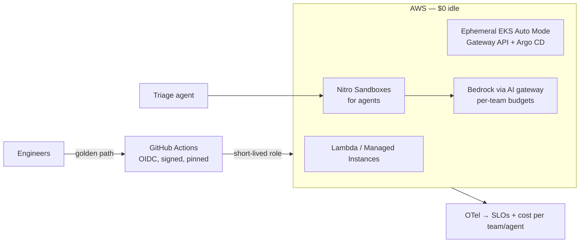

# Runway

**A small internal platform that lets a 30-engineer company ship services *and* AI agents safely: self-service, short-lived identity, sandboxed agents, metered cost, real SLOs. Built on real AWS at $0 when idle.**

> I take chaotic, manual, risky environments and make them boring, self-service and cheap. Runway is that, done in public.

## The scenario

A fictional LA company runs four workloads: a marketing site with a quote form, a catalog/orders API, a nightly batch job, and a new **support-triage AI agent** that reads tickets, queries the API and drafts replies.

Today they deploy by hand, share long-lived AWS keys, can't explain their cloud or AI bill, and nobody knows which agent did what. Runway fixes that one lab at a time.



## Labs

Every lab can be done on its own, in any order. Each one ships a proof, a **cost receipt** and an honest "what I'd change".

| Lab | What it proves | Status | Cost |
|---|---|---|---|
| [00 · Ground Rules](labs/00-ground-rules/) | Budgets, OIDC (no static keys), remote state, one-command teardown | 🔨 | ~$0 |
| [01 · Poison-Proof Pipeline](labs/01-poison-proof-pipeline/) | Supply-chain defense that assumes provenance can lie | 💡 | ~$0 |
| [02 · Lambda vs Cluster Break-Even](labs/02-lambda-vs-cluster/) | Architecture decisions with real numbers | 💡 | $5–15 |
| [03 · Ephemeral EKS in 20 Minutes](labs/03-ephemeral-eks/) | EKS Auto Mode, Gateway API, GitOps | 💡 | $1–3/session |
| [04 · Golden Path](labs/04-golden-path/) | Self-service scaffolding with guardrails built in | 💡 | ~$0 |
| [05 · Agent Jail](labs/05-agent-jail/) | Running untrusted AI agents safely | 💡 | $1–3/session |
| [06 · Who Did That? Agent Identity](labs/06-agent-identity/) | Non-human identity and audit | 💡 | $1–3/session |
| [07 · Token Meter](labs/07-token-meter/) | FinOps for AI: cost per team, agent and ticket | 💡 | $2–10 |
| [08 · SLOs + Governed AIOps](labs/08-slos-aiops/) | SRE basics, and an agent that proposes while a human approves | 💡 | ~$0 |
| [09 · Repatriation Drill](labs/09-repatriation-drill/) | Hybrid/on-prem: KubeVirt, CloudNativePG, TCO | 💡 | ~$0 |
| [10 · Game Day](labs/10-game-day/) | Backup/restore against RPO/RTO, postmortem | 💡 | <$3 |
| [11 · Build-vs-Buy Memo](labs/11-build-vs-buy/) | Business judgment in the "SaaSpocalypse" era | 💡 | ~$0 |
| [D · Disconnected-Ready](labs/d-disconnected-ready/) *(optional)* | Zarf packaging + evidence bundle | 💡 | ~$0 |

✅ done · 🔨 in progress · 💡 planned

## How this repo is organized

```
labs/        one folder per lab: README (template below), Makefile, infra, proof
platform/    reusable pieces labs graduate into (IaC modules, GitOps config)
apps/        the workloads: catalog-api, site, triage-agent
tools/       reaper, cost report, load tests, kb-check
kb/          small cross-lab knowledge base (≤ 8 files): how it runs, trend radar, research
templates/   the one lab README template
```

Work is tracked in Linear. How the project runs is described in [kb/how-this-works.md](kb/how-this-works.md).

## How I used AI on this repo

Claude helped plan the project and works some issues as a background agent. Every change arrives as a pull request that I review. Agents never get AWS credentials: anything that touches AWS goes through GitHub Actions with a short-lived OIDC role. Times the AI was wrong get logged in the lab's "What broke" section.
